# 01 — Project Overview

- **Document Version**: 1.0.0
- **Status**: IMPLEMENTED AND VERIFIED
- **Last Reviewed**: 2026-11-11
- **Target Audience**: University Executives, Department Heads, Developers, Evaluators

---

## 1. Project Introduction

**CampusConnect** is a full-stack, multi-tenant digital grievance and help management system built specifically for higher education institutions. It connects students directly with academic and administrative service departments (e.g., Accounts, Examination, Hostel, IT Support, Library, and Training & Placement), completely replacing physical paperwork, disjointed email chains, and queue-based office visits with an auditable, transparent digital lifecycle.

---

## 2. Problem Statement

Educational institutions face persistent administrative hurdles when managing student inquiries and complaints:
1. **Physical Congestion & Inefficiency**: Students must physically visit administrative offices during limited office hours to submit requests, leading to crowded halls and wasted academic time.
2. **Lack of Caseload Visibility**: Department heads lack clear dashboards indicating pending vs. overdue requests, resolution turnaround times, or staff caseload distribution.
3. **Missing Audit Trails**: Paper slips and verbal assurances lack immutable timestamps, assigned officer tracking, or formal escalation milestones.
4. **Communication Silos**: Students have no unified portal to track whether their complaint is pending, assigned to an officer, in progress, or resolved.
5. **Cross-Tenant Risks**: Colleges operating multiple faculties or independent sister campuses require strict institutional data isolation to prevent students or staff from viewing or tampering with records belonging to other campuses.

---

## 3. Project Objectives

- **Digitize End-to-End Caseloads**: Provide a single web application for submitting, routing, assigning, resolving, and rating college grievances.
- **Enforce Multi-Tenant Isolation**: Ensure all database queries, authentication sessions, departments, staff accounts, and notifications are strictly scoped by `institutionId`.
- **Provide Actionable Timelines**: Generate automated, timestamped timeline events whenever ticket statuses change or responses are posted.
- **Support Resilient Storage**: Operate seamlessly on MongoDB Atlas with an automated file-based fallback layer in local development.
- **Maintain Defense-in-Depth Security**: Implement strict JWT validation without hardcoded fallbacks, HTTP-only secure cookies, anti-SSRF socket connection pinning, and double-submit CSRF tokens.

---

## 4. Scope

### In-Scope (Implemented and Verified)
- Multi-tenant student registration and login against approved institutions.
- Student complaint and help request submission with optional image/document attachments.
- Department-based automatic request routing.
- Staff ticket management: status transitions (`pending` -> `assigned` -> `in_progress` -> `resolved` -> `closed` / `rejected`), priority tagging, officer assignment, public responses, and staff-only internal notes.
- Student satisfaction feedback (1 to 5 stars + remarks) on resolved tickets.
- Student ticket reopening mechanism with mandatory justification.
- Superadmin dashboard: department creation/editing, subdepartment configuration, staff account creation and locking, student directory with search, institutional audit logs, and analytics.
- Institution-wide and department-specific announcements.
- User profile viewing and contact detail updates (`name`, `phone`).
- Secure session management via HttpOnly cookies and optional Bearer tokens.

### Out-of-Scope / Future Enhancements (Planned)
- Direct SMS / WhatsApp integration for ticket alerts.
- Video conferencing or live chat office hours.
- Automated ML ticket classification (the application currently uses deterministic category-to-department routing).
- Native mobile applications (iOS/Android) — current delivery is responsive Web SPA.

---

## 5. Main Users & Roles

```mermaid
graph TD
    SuperAdmin[Super Administrator] -->|Manages| InstProfile[Institution Profile]
    SuperAdmin -->|Configures| Depts[Departments & Subdepartments]
    SuperAdmin -->|Provisions| StaffAccs[Staff Accounts]
    SuperAdmin -->|Monitors| AuditLogs[Institutional Audit Logs & Analytics]

    Staff[Department Staff] -->|Triages| DeptQueue[Department Ticket Queue]
    Staff -->|Assigns| Officers[Officer Assignment]
    Staff -->|Updates| TicketStatus[Status & Public Responses]
    Staff -->|Records| InternalNotes[Confidential Staff Notes]

    Student[Student] -->|Submits| Grievance[Complaints & Help Requests]
    Student -->|Monitors| Timeline[Real-time Ticket Timeline]
    Student -->|Rates| Feedback[Resolution Star Rating]
    Student -->|Reopens| Reopen[Ticket Reopening with Reason]
```

1. **Student (`role: 'student'`)**:
   - Registered under a specific college with verified name, enrollment number, and email.
   - Can submit tickets, attach files, review status updates, rate resolutions, and reopen tickets.
2. **Department Staff (`role: 'staff'`)**:
   - Assigned to a specific department (e.g., `academic`, `hostel`, `accounts`).
   - Views incoming tickets routed to their department, assigns officers, sets priorities, publishes official updates, and records internal notes.
3. **Super Administrator (`role: 'superadmin'`)**:
   - Institutional owner with overall control over their campus.
   - Configures college profiles, creates departments, manages staff credentials, searches student directories, and views security audit logs.

---

## 6. Main Modules & Implemented Features

### Module 1: Institutional Multi-Tenancy
- **Implementation Status**: IMPLEMENTED AND VERIFIED.
- All primary models (`students`, `staffs`, `departments`, `requests`, `notifications`, `announcements`, `auditlogs`) contain mandatory `institutionId` scoping.
- Cross-tenant requests are blocked at the middleware and route layer, returning HTTP 404 (anti-enumeration) or HTTP 403.

### Module 2: Ticket Routing & Lifecycle Engine
- **Implementation Status**: IMPLEMENTED AND VERIFIED.
- Tickets are categorized as either `complaint` or `help`.
- The student selects a target department (e.g., Library, Transport, Accounts).
- Status follows an audited state machine:
  `pending` -> `assigned` -> `in_progress` -> `resolved` -> `closed` (or `rejected`).
- When a ticket is `resolved`, the student can submit a 1–5 star rating or request reopening if the grievance was inadequately addressed.

### Module 3: Security & Session Management
- **Implementation Status**: IMPLEMENTED AND VERIFIED.
- Strict JWT signing with rejection of predictable defaults (e.g., `campusconnect-secret-key-2026`) and secrets under 32 bytes in production.
- Double-submit CSRF cookie protection for state-changing HTTP methods (`POST`, `PUT`, `PATCH`, `DELETE`).
- Outbound SSRF guard featuring DNS pre-validation, private IP range blocks (RFC 1918, link-local, cloud metadata), and TCP socket connection pinning to neutralize DNS rebinding.

### Module 4: Notifications & Announcements
- **Implementation Status**: IMPLEMENTED AND VERIFIED.
- Targeted in-app notifications generated on ticket status changes, officer assignments, and feedback submissions.
- Broadcast announcements with target audience filters (`all`, `student`, `staff`).

---

## 7. Current Limitations & Constraints

1. **Storage Backend**: Attachments are currently stored on the local container filesystem under `.data/uploads/` (or `/uploads/`). While an abstracted `GoogleCloudStorageProvider` interface exists in `src/server/storage.ts`, Cloud Storage bucket provisioning is pending infrastructure approval.
2. **Email Delivery**: Email dispatch via Resend is implemented in `src/server/email.ts` with graceful fallback to console logging if `RESEND_API_KEY` is not supplied. Production domain verification on Resend remains pending.
3. **Database Topology**: The production cluster connects to MongoDB Atlas. Network isolation currently relies on Atlas IP access rules (`0.0.0.0/0` until a dedicated Cloud NAT / static IP is configured).
