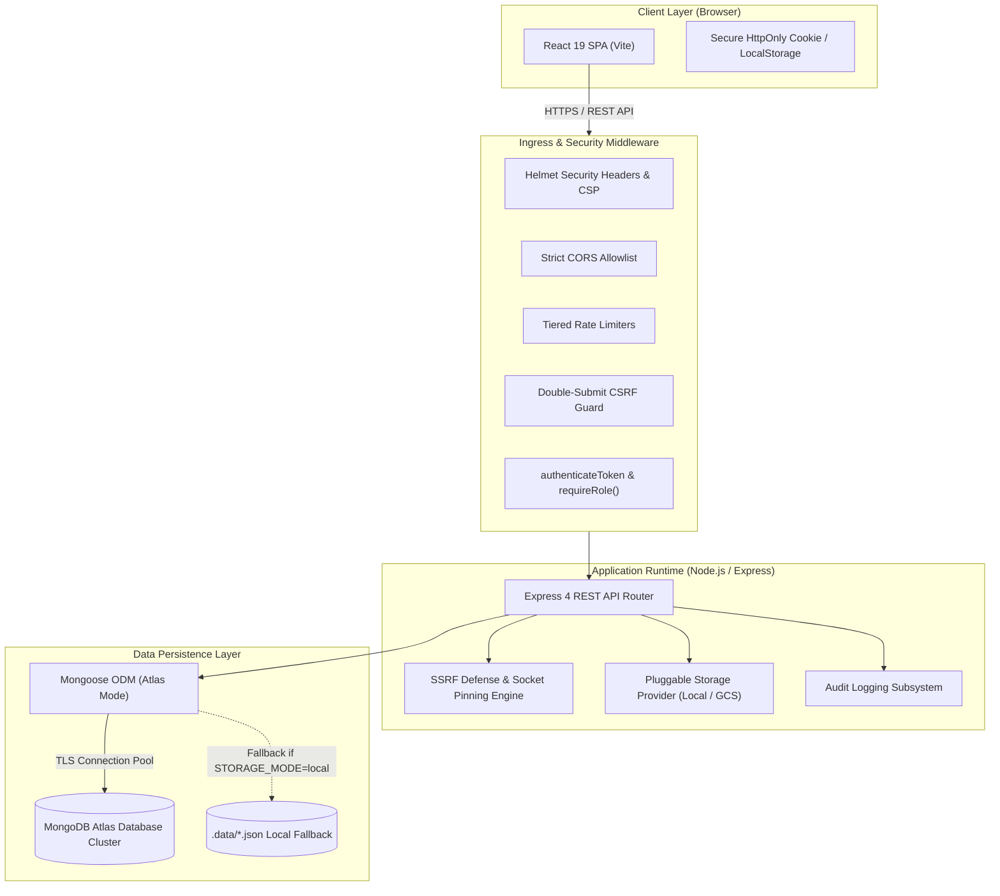
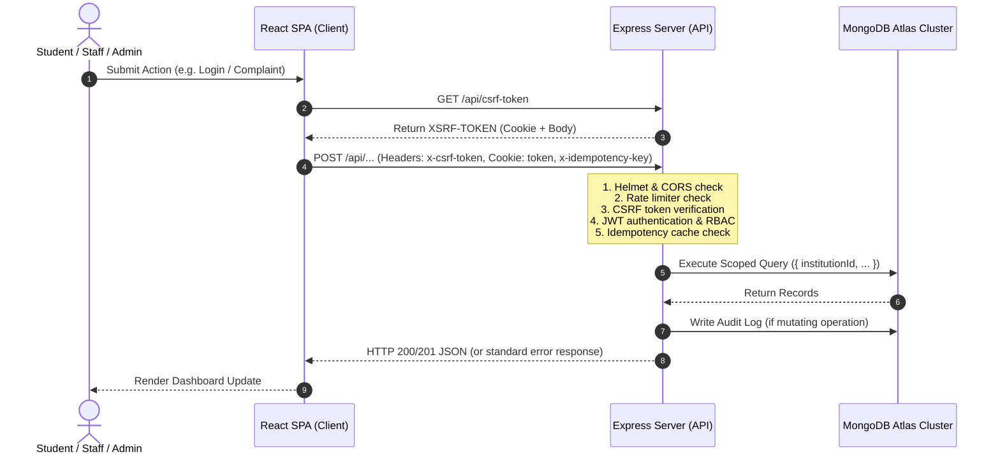
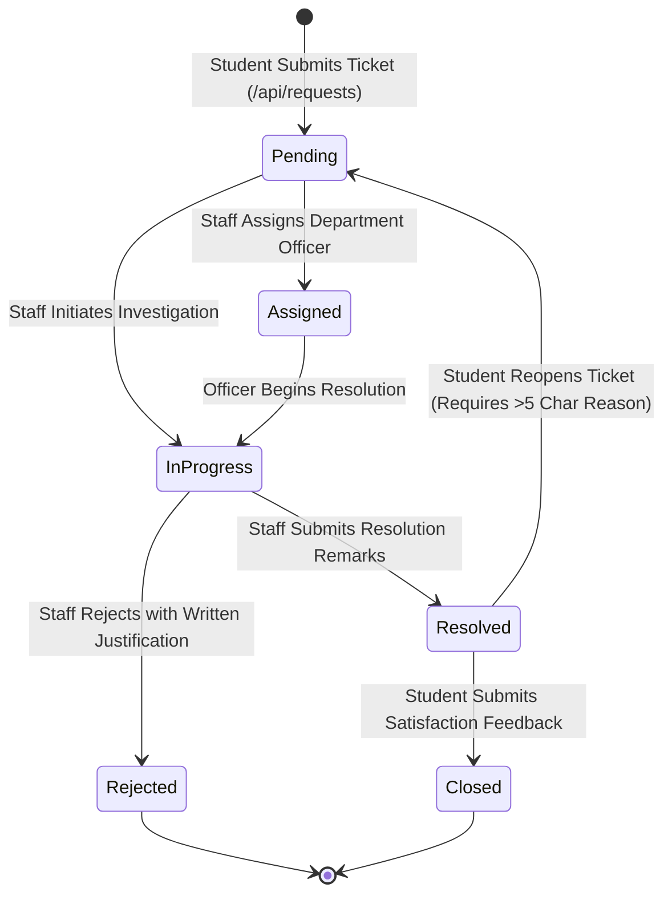
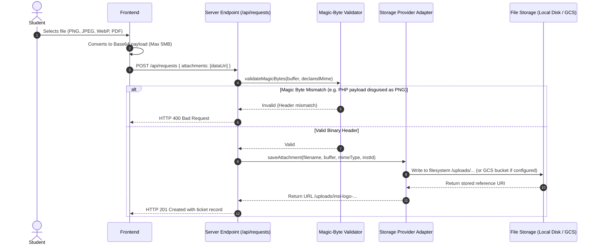

# 02 — System Architecture

- **Document Version**: 1.0.0
- **Status**: IMPLEMENTED AND VERIFIED
- **Last Reviewed**: 2026-11-11
- **Target Audience**: Software Engineers, System Architects, DevOps, Technical Auditors

---

## 1. High-Level Architecture

CampusConnect is structured as a full-stack, decoupled Web application where a React Single Page Application (SPA) communicates over HTTPS with a stateless Express REST API backend. The backend persists data to MongoDB Atlas with an automatic fallback to local JSON repository storage during development.



---

## 2. Component Interaction & Communication

Communication between the client and server occurs via JSON payloads over RESTful HTTP endpoints, complemented by multipart form data for file uploads.



---

## 3. Authentication & Session Architecture

CampusConnect uses stateless JSON Web Tokens (JWT) signed with HMAC-SHA256. Tokens are delivered to the client via `HttpOnly`, `SameSite=Lax`, `Secure` (in production) cookies, while also accepting standard `Authorization: Bearer <token>` headers for programmatic or mobile clients.

```mermaid
sequenceDiagram
    autonumber
    actor User as User (Student / Admin / Staff)
    participant Client as React SPA
    participant Auth as Auth Service (/api/auth)
    participant DB as Database

    User->>Client: Enters credentials (Email/Enrollment & Password)
    Client->>Auth: POST /api/auth/login { identifier, password, institutionId }
    Auth->>DB: Find user by email/enrollment + institutionId
    DB-->>Auth: Return user record with bcrypt password hash
    Auth->>Auth: bcrypt.compare(password, hashedPassword)
    alt Password Invalid
        Auth-->>Client: HTTP 401 Unauthorized (Invalid credentials)
    else Password Valid
        Auth->>Auth: generateToken(payload, JWT_SECRET, "7d")
        Auth-->>Client: HTTP 200 OK (Set-Cookie: token=...; HttpOnly; SameSite=Lax)
        Client->>Client: Store user session profile in state
        Client-->>User: Navigate to Role Dashboard
    end
```

---

## 4. Student Complaint Lifecycle State Machine

The complaint resolution engine operates on an audited, deterministic state machine. State changes automatically append timeline milestones and issue targeted notifications to the student.



---

## 5. Multi-Tenant Data Isolation Model

Every administrative and student operation is hard-scoped to the user's `institutionId`. The application strictly prevents tenant data leakage:

```mermaid
graph TD
    subgraph InstitutionA["Institution A Boundary (e.g. Hindu University)"]
        AdminA[Admin A] --> DeptsA[Departments A]
        DeptsA --> StaffA[Staff A]
        StudentsA[Students A] --> TicketsA[Tickets & Caseload A]
        TicketsA --> AuditA[Audit Logs A]
    end

    subgraph InstitutionB["Institution B Boundary (e.g. Sister Campus)"]
        AdminB[Admin B] --> DeptsB[Departments B]
        DeptsB --> StaffB[Staff B]
        StudentsB[Students B] --> TicketsB[Tickets & Caseload B]
        TicketsB --> AuditB[Audit Logs B]
    end

    AdminA -.->|Cross-Tenant Access BLOCKED (HTTP 404 / 403)| TicketsB
    AdminB -.->|Cross-Tenant Access BLOCKED (HTTP 404 / 403)| TicketsA
    StaffA -.->|Cross-Tenant Access BLOCKED| DeptsB
```

### Isolation Enforcement Rules:
1. **Creation**: Student registration enforces that the requested `institutionId` matches an active institution.
2. **Querying**: Queries on `requests`, `departments`, `announcements`, `auditlogs`, and `students` include `{ institutionId: req.user.institutionId }`.
3. **Deletion & Mutation**: Deletion queries (e.g. student deletion) execute atomic filters: `StudentModel.findOneAndDelete({ id: targetId, institutionId: req.user.institutionId })`. If the target belongs to another institution, it returns `404 Not Found` (Anti-Enumeration defense).

---

## 6. Attachment & File Storage Architecture



---

## 7. External Integrations & Cloud Infrastructure Status

| Subsystem | Implemented Component | Operational Status | Notes / Prerequisites |
|---|---|:---:|---|
| **Database** | MongoDB Atlas Cluster | **VERIFIED** | Connected via Mongoose over TLS (`readyState: 1`). |
| **Email Service** | Resend SDK (`resend` package) | **PARTIALLY IMPLEMENTED** | Integrated in `src/server/email.ts`; requires active `RESEND_API_KEY` for live delivery. |
| **File Storage** | `LocalDiskStorageProvider` | **VERIFIED** | Files stored locally in `.data/uploads/`. |
| **Cloud Storage** | `GoogleCloudStorageProvider` | **PLANNED** | Code exists in `src/server/storage.ts`; bucket provisioning pending approval. |
| **Cloud Egress** | Cloud NAT + Static IP | **PLANNED** | Architecture designed; requires VPC Connector provisioning to restrict Atlas IP whitelist. |
