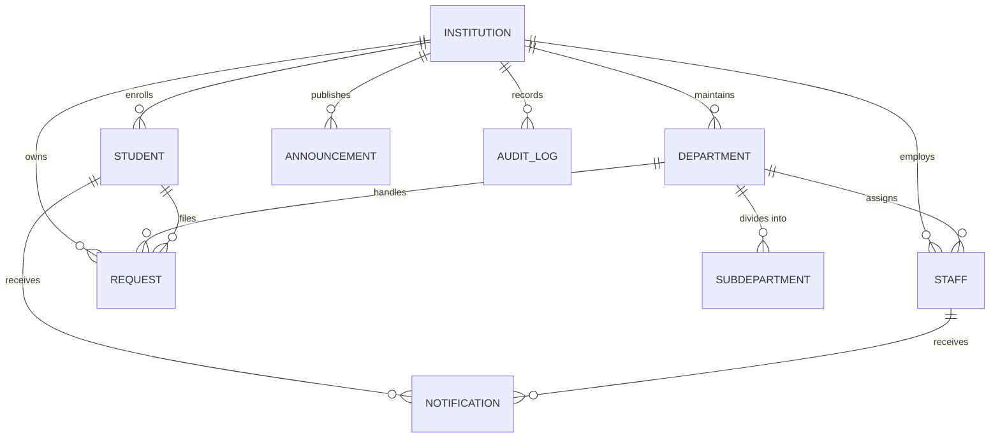

# 06 — Database and Data Model

- **Document Version**: 1.0.0
- **Status**: IMPLEMENTED AND VERIFIED
- **Last Reviewed**: 2026-11-11
- **Target Audience**: Database Administrators, Backend Engineers, Data Architects

---

## 1. Database Architecture Overview

CampusConnect employs a multi-tenant document database model hosted on **MongoDB Atlas** (using Mongoose 9.7 as the ODM). All core collections enforce shared-database, tenant-isolated tenancy where every document contains an immutable `institutionId`.

---

## 2. Collection Schemas & Data Models

### 1. `institutions` Collection
Represents college and university tenants registered on the platform.
- **Mongoose Model**: `InstitutionModel`
- **Primary Identifier**: `id` (`String`, e.g. `inst-1792319961187`)
- **Key Fields**:
  - `name` (`String`, Required): Official institutional name.
  - `type` (`String`, Required): e.g. `University`, `College`, `Institute`.
  - `address`, `city`, `state`, `country`, `postalCode` (`String`): Geographical address details.
  - `officialEmail` (`String`): Central contact / administrative email.
  - `website` (`String`): Institutional portal URL.
  - `logo` (`String`): URL or path to uploaded institutional crest.
  - `isTest` (`Boolean`, Default `false`): Flags synthetic test fixtures.
  - `status` (`String`, Enum `['active', 'inactive', 'test']`, Default `'active'`).
  - `createdAt` (`String`, ISO Timestamp): Registration timestamp.

---

### 2. `students` Collection
Stores student user accounts tied to a specific institution.
- **Mongoose Model**: `StudentModel`
- **Primary Identifier**: `id` (`String`, e.g. `student-1792320685750`)
- **Key Fields**:
  - `name` (`String`, Required): Full student name.
  - `enrollmentNumber` (`String`, Required): College roll / matriculation number.
  - `email` (`String`, Required, Unique): Institutional or personal email.
  - `contactNumber` (`String`, Required): Phone contact.
  - `password` (`String`, Required): Bcrypt salted hash (10 rounds).
  - `institutionId` (`String`, Required): Foreign key referencing `institutions.id`.
  - `createdAt` (`String`, ISO Timestamp).
  - `resetPasswordToken` (`String`, Optional): Temporary reset verification token.
  - `resetPasswordExpires` (`String`, Optional): Token expiration timestamp.
- **Indexes**:
  - `{ institutionId: 1, enrollmentNumber: 1 }` (Enforces unique enrollment within an institution).
  - `{ email: 1 }` (Unique email index).

---

### 3. `departments` Collection
Academic, administrative, and maintenance divisions handling student grievances.
- **Mongoose Model**: `DepartmentModel`
- **Primary Identifier**: `id` (`String`, e.g. `dept-inst-...-academic`)
- **Key Fields**:
  - `key` (`String`, Required): Machine-readable key (e.g. `academic`, `accounts`, `library`, `hostel`, `transport`, `placement`, `examination`, `administration`, `itsupport`).
  - `name` (`String`, Required): Display title (e.g. `Examination Department`).
  - `officialPhone`, `officialEmail` (`String`, Required): Contact channels.
  - `head` (`String`, Optional): Name of the designated department chair.
  - `status` (`String`, Enum `['active', 'inactive']`, Default `'active'`).
  - `institutionId` (`String`, Required): Tenant identifier.
  - `username` (`String`, Optional): Optional department login username.
- **Indexes**:
  - `{ key: 1, institutionId: 1 }` (Unique department key per campus).
  - `{ username: 1, institutionId: 1 }` (Unique username per campus).

---

### 4. `subdepartments` Collection
Specialized sub-branches within an academic department (e.g. branches like CSE(AIML)).
- **Mongoose Model**: `SubDepartmentModel`
- **Key Fields**:
  - `id` (`String`, Unique): Subdepartment identifier.
  - `name` (`String`, Required): Division name (e.g. `CSE(AIML)`).
  - `headName` (`String`): Head of department / branch lead.
  - `officialEmail`, `contactNumber` (`String`): Contact details.
  - `departmentKey` (`String`, Required): Parent department key (e.g. `academic`).
  - `institutionId` (`String`, Required): Tenant identifier.

---

### 5. `staffs` Collection
Staff and superadministrator accounts.
- **Mongoose Model**: `StaffModel`
- **Primary Identifier**: `id` (`String`)
- **Key Fields**:
  - `name` (`String`, Required): Staff officer full name.
  - `email` (`String`, Required): Login email address.
  - `password` (`String`, Required): Bcrypt salted hash.
  - `departmentKey` (`String`, Required): Department scope (`administration` for superadmins).
  - `role` (`String`, Enum `['staff', 'superadmin']`, Required).
  - `disabled` (`Boolean`, Default `false`): Administrative account freeze.
  - `institutionId` (`String`, Required): Tenant identifier.
  - `failedLoginAttempts` (`Number`, Default `0`): Lockout tracker.
  - `lockedUntil` (`String`, Optional): Lockout expiration timestamp.
  - `forcePasswordChange` (`Boolean`, Default `false`): First-login password rotation flag.
- **Indexes**:
  - `{ email: 1, institutionId: 1 }` (Unique staff email per institution).

---

### 6. `requests` Collection (Complaints & Help Requests)
The core operational records tracking student grievances through resolution.
- **Mongoose Model**: `RequestModel`
- **Primary Identifier**: `id` (`String`, e.g. `req-1792320808612`)
- **Key Fields**:
  - `studentId` (`String`, Required): Reference to `students.id`.
  - `studentName`, `enrollmentNumber`, `contactNumber` (`String`): Cached student metadata.
  - `departmentKey` (`String`, Required): Assigned department.
  - `requestType` (`String`, Enum `['complaint', 'help']`, Required).
  - `subject`, `description` (`String`, Required): Ticket narrative.
  - `status` (`String`, Enum `['pending', 'assigned', 'in_progress', 'resolved', 'rejected', 'closed']`).
  - `priority` (`String`, Enum `['low', 'medium', 'high', 'urgent']`, Default `'medium'`).
  - `officerId`, `officerName` (`String`, Optional): Assigned handling staff member.
  - `response` (`String`, Optional): Public resolution remarks from staff.
  - `internalNotes` (`String`, Optional): Confidential notes visible only to staff/admin.
  - `attachments` (`[String]`): Array of stored file references (`/uploads/...`).
  - `feedback` (`Object`):
    - `rating` (`Number`, 1–5 stars).
    - `remarks` (`String`).
    - `submittedAt` (`String`, ISO Timestamp).
  - `timeline` (`[Object]`):
    - `step`, `title`, `subtitle`, `timestamp`, `actor`, `remarks`, `statusChange`.
  - `institutionId` (`String`, Required): Tenant identifier.
- **Indexes**:
  - `{ institutionId: 1, studentId: 1, createdAt: -1 }` (Student personal history).
  - `{ institutionId: 1, departmentKey: 1, status: 1 }` (Staff queue filtering).
  - `{ institutionId: 1, status: 1, createdAt: -1 }` (Admin oversight & metrics).

---

### 7. `notifications` Collection
Event-driven alerts delivered to students and staff.
- **Mongoose Model**: `NotificationModel`
- **Key Fields**:
  - `id` (`String`, Unique): Notification identifier.
  - `title`, `message` (`String`, Required): Notification content.
  - `recipientId` (`String`, Required): Specific user ID (`studentId` or `staffId`) or `'all'`.
  - `recipientRole` (`String`, Enum `['student', 'staff', 'all']`).
  - `isRead` (`Boolean`, Default `false`).
  - `createdAt` (`String`, ISO Timestamp).
  - `institutionId` (`String`, Required): Tenant identifier.

---

### 8. `announcements` Collection
Institutional notices published by administrators or department chairs.
- **Mongoose Model**: `AnnouncementModel`
- **Key Fields**:
  - `id` / `announcementId` (`String`): Identifier.
  - `title`, `description` (`String`, Required): Notice content.
  - `departmentId` (`String`, Nullable): `null` for campus-wide; department key for targeted.
  - `priority` (`String`, Enum `['low', 'medium', 'high', 'urgent']`).
  - `createdBy`, `creatorRole` (`String`): Author tracking.
  - `publishDate`, `expiryDate` (`String`): Visibility scheduling.
  - `institutionId` (`String`, Required): Tenant identifier.

---

### 9. `auditlogs` Collection
Immutable administrative audit log tracking critical mutations.
- **Mongoose Model**: `AuditLogModel`
- **Key Fields**:
  - `id` (`String`): Unique audit event ID.
  - `adminId`, `adminName` (`String`, Required): Actor details.
  - `actionType` (`String`, Required): e.g. `CREATE_STAFF`, `UPDATE_DEPARTMENT`, `DELETE_STUDENT`.
  - `departmentKey`, `details` (`String`): Contextual action metadata.
  - `timestamp` (`String`, Required): Immutable event timestamp.
  - `ipAddress` (`String`): Client IP address.
  - `institutionId` (`String`, Required): Tenant identifier.
- **Index**:
  - `{ institutionId: 1, timestamp: -1 }` (Reverse chronological audit queries).
