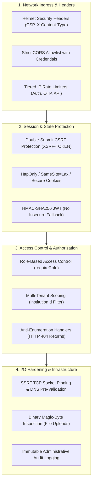

# 08 — Authentication and Security

- **Document Version**: 1.0.0
- **Status**: IMPLEMENTED AND VERIFIED
- **Last Reviewed**: 2026-11-11
- **Target Audience**: Security Engineers, Penetration Testers, Backend Developers, Technical Auditors

---

## 1. Security Architecture Summary

CampusConnect implements a defense-in-depth security model protecting student identity, staff authority, and administrative integrity across all application layers.



---

## 2. Authentication & Session Security

### 1. JWT Implementation & Strict Secret Validation (P0 Security Fix 3)
- **Implementation**: `src/server/auth.ts` (`generateToken`, `authenticateToken`, `validateJwtConfiguration`).
- **Algorithm**: HMAC-SHA256 (`HS256`), signed with `process.env.JWT_SECRET`.
- **Token Expiry**: Default 7 days (`7d`).
- **Fail-Fast Production Validation**:
  - In production (`NODE_ENV === 'production'`), the server strictly validates `JWT_SECRET` during boot.
  - Rejects missing, empty, or whitespace secrets.
  - Rejects known insecure defaults (e.g., `campusconnect-secret-key-2026`).
  - Rejects weak secrets under 32 bytes (256-bit entropy).
  - In development, if unconfigured, auto-generates a process-local ephemeral key with a terminal notice.
- **Verification**: Verified by `test/jwt-config-security.test.ts` (11/11 tests pass).

### 2. Password Hashing & Rotation
- **Implementation**: `server.ts` using `bcryptjs`.
- **Algorithm**: Salted bcrypt with a cost factor of 10 rounds.
- **Rules**:
  - Minimum 6 characters.
  - Plaintext passwords are never saved, logged, or returned in API responses.
  - Authenticated password changes strictly reject identical old and new passwords.

### 3. Session Delivery (Cookies & Bearer Support)
- **Primary Delivery**: Sent via `Set-Cookie: token=<jwt>; HttpOnly; SameSite=Lax; Path=/`.
- **Production Flags**: When `NODE_ENV === 'production'`, the `Secure` flag is enforced, restricting transmission strictly to HTTPS connections.
- **Programmatic Clients**: In addition to cookies, `authenticateToken` checks `Authorization: Bearer <token>` headers for mobile or testing clients.

---

## 3. Ingress Hardening & Vulnerability Defenses

### 1. CSRF Protection (Double-Submit Cookie Pattern)
- **Implementation**: `src/server/security.ts` (`verifyCsrfProtection`, `csrfTokenProvider`).
- **Mechanism**:
  - A cryptographically secure 64-character hex token is generated via `crypto.randomBytes(32).toString('hex')`.
  - Set in client-accessible cookie `XSRF-TOKEN` (`SameSite=Lax`).
  - Frontend extracts this token and transmits it back via `x-csrf-token` header.
  - All mutating requests (`POST`, `PUT`, `PATCH`, `DELETE`) are verified using constant-time timing-safe comparison (`crypto.timingSafeEqual`) to prevent timing attacks.

### 2. SSRF Protection & Socket Connection Pinning (P0 / Phase A Hardening)
- **Implementation**: `src/server/ssrf.ts` (`safeFetchResource`, `validateDestinationUrl`).
- **Guards Enforced**:
  1. **Protocol Restriction**: Rejects all non-HTTP/HTTPS protocols (`ftp://`, `gopher://`, `file://`).
  2. **Credential Stripping**: Rejects URLs containing embedded user info (`user:pass@host`).
  3. **Port Filtering**: Strictly limits external requests to standard HTTP ports (`80`, `443`, `8080`, `8443`). Prohibits ports like `22`, `6379`, `27017`.
  4. **Private IP Blocking**: Resolves and validates against loopback (`127.0.0.0/8`, `::1`), link-local (`169.254.0.0/16`), RFC 1918 private subnets (`10.0.0.0/8`, `172.16.0.0/12`, `192.168.0.0/16`), and Cloud metadata (`metadata.google.internal`).
  5. **Anti-TOCTOU Socket Pinning**: To eliminate Time-of-Check to Time-of-Use DNS rebinding, `safeFetchResource` passes a custom `lookup` callback to Node's `http.request` / `https.request`. The TCP connection is pinned directly to the pre-validated IP while passing `servername: parsed.hostname` to preserve TLS SNI certificate validation.
- **Verification**: Verified by `test/ssrf-protection.test.ts` (9/9 pass).

### 3. Tiered Rate Limiting
- **Implementation**: `src/server/security.ts` (`createRateLimiters`).
- **Tier Configuration**:

| Endpoint Category | Production Threshold | Dev / Test Threshold | Window |
|---|:---:|:---:|:---:|
| **Login & Register** (`/api/auth/login`, `/register`) | **10 requests** | 200 requests | 15 minutes |
| **Forgot Password** (`/api/auth/forgot-password`) | **3 requests** | 50 requests | 15 minutes |
| **OTP Verification** (`/api/auth/verify-otp`) | **5 requests** | 50 requests | 15 minutes |
| **Change Password** (`/api/auth/change-password`) | **5 requests** | 50 requests | 15 minutes |
| **General API** (`/api/*`) | **150 requests** | 2,000 requests | 15 minutes |

---

## 4. Multi-Tenant Authorization & IDOR Defenses

### 1. Role-Based Access Control (`requireRole`)
- Protects administrative endpoints against role escalation.
- Enforced roles: `student`, `staff`, `superadmin`.
- Unauthorized roles receive immediate `403 Forbidden`.

### 2. Tenant Scoping & Anti-Enumeration (P0 Security Fix 2)
- Students and administrators are strictly confined to their own institution.
- **Cross-Tenant Deletion Guard**:
  When a superadmin attempts to delete a student, the backend executes:
  ```typescript
  const result = await db.students.delete(targetStudentId, requestingUser.institutionId);
  ```
  If the student exists in another college or does not exist, the API returns **`404 Not Found`** ("Target student record not found within your institution"). This deliberately avoids returning `403 Forbidden` to prevent malicious actors from enumerating valid student IDs across other institutions.
- **Verification**: Verified by `test/tenant-student-deletion-security.test.ts` (11/11 tests pass).

---

## 5. File Upload & Binary Magic-Byte Security (Phase A Hardening)

- **Implementation**: `src/server/storage.ts` (`validateMagicBytes`).
- **Vulnerability Mitigated**: Prevents attackers from uploading executable scripts (e.g. PHP, HTML, shell scripts) disguised with spoofed `.png` or `image/jpeg` MIME types.
- **Signatures Verified**:
  - **PNG**: `89 50 4E 47 0D 0A 1A 0A`
  - **JPEG**: `FF D8 FF`
  - **WebP**: `52 49 46 46` ... `57 45 42 50`
  - **PDF**: `25 50 44 46` (`%PDF`)
- Buffers whose initial bytes do not match the expected binary magic signature are rejected with `400 Bad Request`.

---

## 6. Audit Logging & Compliance

- **Implementation**: `src/server/db.ts` (`AuditLogModel`).
- **Events Logged**:
  - Staff creation, update, and deletion.
  - Department and subdepartment configuration changes.
  - Administrative student account deletions.
  - Staff lockout toggling and password resets.
  - Student profile updates (`PATCH /api/students/me`).
- **Stored Attributes**: `adminId`, `adminName`, `actionType`, `departmentKey`, `details`, `ipAddress`, `institutionId`, and immutable `timestamp`.
- **Compliance Note**: All prior claims referring to formal government certifications (such as `FIPS 140-2`) have been removed from the application UI, as standard Node.js cryptographic containers lack CMVP hardware validation.
