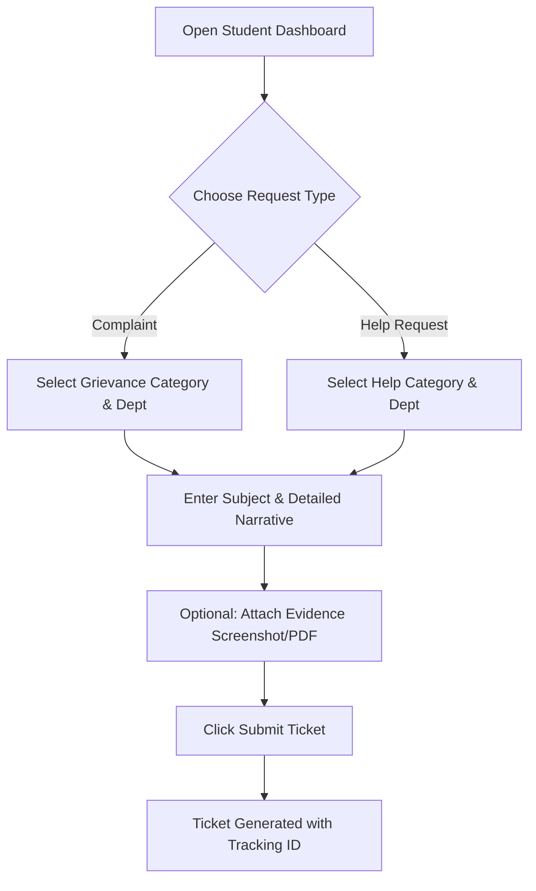

# 09 — Student User Guide

- **Document Version**: 1.0.0
- **Status**: IMPLEMENTED AND VERIFIED
- **Last Reviewed**: 2026-11-11
- **Target Audience**: Enrolled Students, Student Support Staff, Campus Counselors

---

## 1. Getting Started: Institution Selection & Account Creation

### Step 1: Access the Portal & Select Institution
1. Open your browser and navigate to the CampusConnect portal URL.
2. On the landing page banner, locate the **Select Your Institution** dropdown.
3. Choose your college (e.g. **HINDU UNIVERSITY**).
4. The application will automatically scope your session to that institution.

### Step 2: Student Registration
1. In the top navigation bar, click **Sign In / Register**.
2. Select the **Student** tab, then toggle to **Create Account**.
3. Fill in the required fields:
   - **Full Name**: Enter your name as it appears in college records.
   - **Enrollment Number**: Enter your unique college matriculation code (e.g. `STU1001`).
   - **Email Address**: Enter your student or personal email.
   - **Contact Number**: Enter a valid 10-digit mobile number.
   - **Password**: Create a secure password (minimum 6 characters).
4. Click **Create Student Account**.
5. Once registered, you will be automatically logged in and redirected to your **Student Dashboard**.

---

## 2. Student Authentication & Password Management

### Step 1: Standard Student Login
1. Click **Sign In** on the top navigation bar.
2. Select the **Student** role tab.
3. Enter your **Email Address** (or Enrollment Number) and **Password**.
4. Click **Sign In**.

### Step 2: Forgot Password & OTP Recovery
If you lose your password:
1. In the login modal, click **Forgot Password?**.
2. Enter your registered email address and click **Send OTP Code**.
3. Check your email inbox for a 6-digit verification code.
4. Enter the code in the verification screen.
5. Provide and confirm your **New Password**.
6. Click **Reset Password** to complete recovery.

### Step 3: Changing Your Password
1. Click your name in the sidebar navigation and select **Change Password**.
2. Enter your **Current Password**.
3. Enter your **New Password** (must differ from your current password).
4. Click **Update Password**.

---

## 3. Submitting Complaints & Help Requests

### Filing a Grievance:
1. On the Student Dashboard, click **New Request** (or **File Complaint**).
2. Choose the **Request Type**:
   - **Complaint**: For maintenance, facility breakdowns, administrative delays, or fee disputes.
   - **Help Request**: For academic guidance, syllabus queries, or document assistance.
3. Select the **Target Department** (e.g. `Hostel`, `Accounts`, `IT Support`, `Library`, `Academic`).
4. Enter a descriptive **Subject** (e.g. `Hostel Room 302 Plumbing Leak`).
5. Provide the **Description** explaining the issue in detail.
6. (Optional) Click **Add Attachment** to upload a screenshot or document:
   - Supported formats: PNG, JPG, WebP, PDF.
   - Maximum size: 5 MB.
7. Click **Submit Request**. Your ticket will appear in your **Active Caseload** list with status `pending`.

---

## 4. Tracking Request Lifecycles & Timelines

### Understanding Status Badges:
| Status | Badge Color | Meaning |
|---|:---:|---|
| **Pending** | Yellow | Ticket submitted; awaiting department triage. |
| **Assigned** | Blue | Department has designated a specific staff officer to your ticket. |
| **In Progress** | Purple | Investigation or physical repairs are actively underway. |
| **Resolved** | Green | Department has completed the work and posted official remarks. |
| **Closed** | Slate / Gray | Ticket resolution accepted and rated by student. |
| **Rejected** | Red | Ticket rejected (with written explanation from staff). |

### Viewing Ticket Details & Timelines:
1. Click on any ticket row in your dashboard.
2. The detailed view displays:
   - Complete issue narrative and attached files.
   - Assigned handling officer name.
   - Official department responses.
   - **Interactive Milestone Timeline**: Every status update, officer assignment, and remark is recorded with a verified timestamp.

---

## 5. Providing Feedback or Reopening Tickets

### Giving Feedback (5-Star Rating):
1. When a ticket transitions to **Resolved**, a satisfaction feedback banner appears.
2. Select your rating from **1 to 5 Stars**.
3. (Optional) Provide feedback remarks (e.g. `Repaired promptly within two hours`).
4. Click **Submit Feedback**. The ticket will finalize to **Closed**.

### Reopening an Unresolved Ticket:
If the issue recurred or was improperly addressed:
1. Open the resolved ticket and click **Reopen Ticket**.
2. You must enter a **Justification Reason** (minimum 5 characters).
3. Click **Confirm Reopen**.
4. The ticket will immediately revert to **Pending**, alerting department staff with your reopening rationale.

---

## 6. Profile Management & Notifications

### Editing Your Profile:
1. Click on your avatar/name in the bottom-left sidebar.
2. In the profile modal, you can view your verified enrollment number and college email.
3. You can update your **Full Name** and **Contact Phone Number**.
4. Identity fields (`Enrollment Number`, `College`, `Role`, `Email`) are locked and immutable.
5. Click **Save Changes**.

### In-App Notifications:
- The bell icon in the header displays unread notifications.
- You will receive automated alerts when:
  - An officer is assigned to your ticket.
  - A staff member posts an update.
  - Your ticket is marked as resolved.
- Click **Mark All Read** to clear badge counters.

### Logging Out:
- Click the **Log Out** button at the bottom of the sidebar to clear your session cookies securely.
