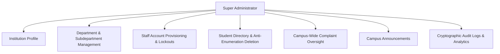

# 10 — Administrator User Guide

- **Document Version**: 1.0.0
- **Status**: IMPLEMENTED AND VERIFIED
- **Last Reviewed**: 2026-11-11
- **Target Audience**: College Administrators, Campus IT Directors, Institutional Owners

---

## 1. Administrative Overview & Access

The Super Administrator (`role: 'superadmin'`) holds overarching governance over their college instance. The administrative dashboard enables complete control over academic and administrative departments, staff provisioning, student records, and institutional audit logs.

---

## 2. Administrator Login

1. Navigate to the CampusConnect portal.
2. Click **Sign In** and select the **Admin** role tab.
3. Enter your Administrator Email and Password.
4. Click **Sign In as Administrator**.
5. Upon successful authentication, the master **Admin Dashboard** opens.

---

## 3. Managing Institutional Configuration

1. In the sidebar, select **Institution Settings** (or **College Profile**).
2. The form allows updating:
   - **Institution Display Name**: Official college title.
   - **Official Website URL**: Institutional domain link.
   - **Official Contact Email & Phone**: Campus support contacts.
   - **Campus Address**: Physical location, city, state, country, postal code.
   - **Institutional Crest / Logo**: Upload an official logo (automatically verified for valid PNG/JPEG headers).
3. Click **Update Institutional Profile**.

---

## 4. Department & Subdepartment Configuration

### Creating a New Department:
1. In the admin navigation, select **Departments**.
2. Click **Add New Department**.
3. Fill in:
   - **Department Key**: A unique machine-readable slug (e.g. `scholarship`, `transportation`).
   - **Department Name**: Public display name (e.g. `Scholarship & Financial Aid`).
   - **Official Phone & Email**: Departmental contact channels.
   - **Department Head**: Designated faculty or staff lead name.
4. Click **Create Department**. The department is instantly available in the student submission dropdown.

### Editing or Deactivating a Department:
- Click the **Edit** button next to any department to update contact details or toggle its status between `active` and `inactive`.

### Configuring Subdepartments:
- To add specialized divisions under an academic department (such as `CSE(AIML)` under `academic`), navigate to the **Subdepartments** tab, click **Add Subdepartment**, provide the division name, HOD, and parent department key, and click **Save**.

---

## 5. Staff Account Provisioning & Security Controls

### Creating a Staff Officer Account:
1. Navigate to **Staff Management**.
2. Click **Create Staff Account**.
3. Provide:
   - **Staff Full Name**.
   - **Official Email Address**.
   - **Assigned Department**: Select which department queue this officer can access.
   - **Role**: Select `staff` (or secondary `superadmin`).
   - **Initial Temporary Password**.
4. Click **Save Staff Account**.

### Administrative Security Actions on Staff:
- **Temporary Password Reset**: Click **Reset Password** on a staff row to issue an immediate temporary password. The staff member will be required to change it upon their next login.
- **Account Freeze / Disable**: Click **Disable Account** to immediately revoke access for a staff member who has left the institution.
- **Account Unlock**: If a staff account is locked due to excessive failed attempts, click **Unlock Account** to restore immediate login capability.

---

## 6. Student Directory & Search

1. Navigate to the **Students** tab.
2. The directory displays all enrolled students with their name, enrollment number, contact email, and registration date.
3. **Search & Filter**: Type an enrollment code, name, or email in the search bar to filter records in real-time.
4. **Pagination**: Large directories are paginated with `20`, `50`, or `100` students per page.
5. **Student Deletion**:
   - Superadmins can click **Delete** to purge a student record.
   - **Tenant Protection**: Deletions are atomic and strictly scoped to `{ id, institutionId }`. You cannot delete or view students enrolled in another institution.

---

## 7. Campus-Wide Complaint Oversight & Analytics

1. In the **Complaints & Grievances** tab, superadmins have visibility over all departmental queues across the college.
2. **Reassigning Tickets**:
   - If a student misrouted a ticket (e.g. filed a scholarship query under the hostel department), the superadmin can click **Reassign Department**, select the correct destination department, enter a brief reason, and update routing.
3. **Analytics Dashboard**:
   - Provides summary metrics:
     - Total tickets submitted.
     - Open vs. In Progress vs. Resolved count.
     - Average resolution turnaround time by department.
     - Student satisfaction rating distribution.

---

## 8. Publishing Campus Announcements

1. In the sidebar, select **Announcements**.
2. Click **New Announcement**.
3. Enter:
   - **Title**: Notice headline.
   - **Description**: Announcement body.
   - **Target Audience**: Select `All`, `Students Only`, or `Staff Only`.
   - **Priority**: Select `Low`, `Medium`, `High`, or `Urgent`.
4. Click **Publish Announcement**. Notices appear immediately on the student and staff dashboards.

---

## 9. Security Audit Logs

1. Click **Audit Logs** in the sidebar.
2. The audit trail records every privileged administrative action:
   - Staff creation and role assignments.
   - Department modifications.
   - Student deletions.
   - Password reset interventions.
3. Each entry includes the executing admin name, IP address, action type, affected department, and immutable timestamp.
