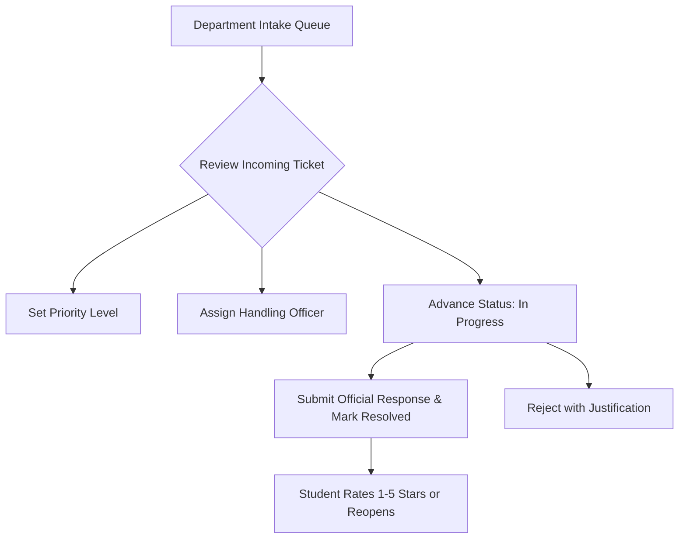

# 11 — Department Staff User Guide

- **Document Version**: 1.0.0
- **Status**: IMPLEMENTED AND VERIFIED
- **Last Reviewed**: 2026-11-11
- **Target Audience**: Department Chairs, Faculty Officers, Administrative Staff, Maintenance Coordinators

---

## 1. Overview & Departmental Scope

Department Staff members (`role: 'staff'`) manage incoming tickets routed to their designated department (e.g. `academic`, `accounts`, `hostel`, `examination`, `library`, `transport`, `itsupport`).

Staff accounts are strictly quarantined to tickets belonging to their own department key and college institution. A staff officer in the Library department cannot access or modify tickets assigned to the Hostel department.

---

## 2. Staff Authentication & Temporary Credentials

### Step 1: Logging In
1. Navigate to CampusConnect and click **Sign In**.
2. Select the **Department Staff** tab.
3. Enter your assigned email address and password.
4. Click **Sign In as Staff**.

### Step 2: First-Time Login (Temporary Password Rotation)
If an administrator created your account with a temporary password:
1. You will be prompted with the **Change Temporary Password** screen upon initial login.
2. Enter the temporary password provided by your admin.
3. Choose and confirm your new permanent password.
4. Click **Confirm Password Change** to enter your dashboard.

---

## 3. Managing the Department Caseload Queue

### Navigating the Queue:
- Upon logging in, the **Assigned Queue** displays all tickets routed to your department.
- Filter by:
  - **Status Tabs**: `Pending`, `Assigned`, `In Progress`, `Resolved`, `Closed`.
  - **Search**: Search by student name, enrollment number, or subject.

---

## 4. Triage & Ticket Actions

Click any ticket row to open the **Caseload Detail View**:

### 1. Assigning a Designated Officer:
- Click the **Assign Officer** dropdown.
- Select the specific staff member responsible for investigating or fixing the issue.
- Click **Save Assignment**. The ticket status transitions to `assigned`, and an automated notification is sent to the student.

### 2. Setting Severity Priority:
- Adjust the ticket urgency: `Low`, `Medium`, `High`, or `Urgent`.
- High and urgent tickets are badged prominently at the top of the department queue.

### 3. Advancing Status:
- When investigation begins, advance the status to **In Progress**.
- When repairs or academic interventions are complete, change the status to **Resolved**.

---

## 5. Public Responses vs. Internal Confidential Notes

CampusConnect provides two distinct communication channels on every ticket:

| Communication Channel | Visibility | Who Can Read | Primary Purpose |
|---|---|---|---|
| **Official Response** | **Public** | Student, Staff, Superadmin | Communicates the official resolution, next steps, or explanation to the student. |
| **Internal Notes** | **Confidential** | Staff & Superadmin Only | Records private diagnostic notes, internal contractor discussions, or sensitive notes. |

### Adding Official Public Responses:
1. Scroll to the **Official Response** text area.
2. Enter your resolution remarks (e.g. `Maintenance contractor replaced the bathroom fixture at 11:30 AM`).
3. Click **Post Response & Update Status**.
4. The student receives an immediate in-app alert.

### Adding Internal Staff Notes:
1. Click the **Internal Notes** tab.
2. Enter internal observations (e.g. `Parts billed under invoice #4810; contractor warned regarding delay`).
3. Click **Save Note**.
4. **Security Invariant**: Internal notes are scrubbed from student API responses and will never appear on the student dashboard.

---

## 6. Handling Reopened Tickets

If a student was dissatisfied with a resolution and reopened the ticket:
1. The ticket will re-appear in the **Pending** tab with a prominent **Reopened** badge.
2. The timeline displays the student's **Reopening Rationale**.
3. Re-assign the ticket, conduct follow-up actions, and update the status accordingly.

---

## 7. Departmental Announcements & Notifications

- **Publishing Departmental Notices**:
  - Staff can publish notices specifically targeting students who have dealings with their department (e.g. `Library Closed for Inventory on Friday`).
- **Notifications**:
  - Receive alerts when new tickets arrive in your queue, when an admin reassigns a ticket to your department, or when a student submits feedback.
