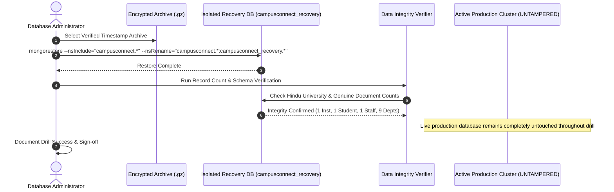

# 14 — Backup and Disaster Recovery

- **Document Version**: 1.0.0
- **Status**: IMPLEMENTED AND VERIFIED (Architecture & Procedures)
- **Last Reviewed**: 2026-11-11
- **Target Audience**: Database Administrators, SRE, Incident Commanders, Cloud Architects

---

## 1. Database Tier & Backup Capability Matrix

The current running cluster uses **MongoDB Atlas M0 (Free Shared Tier)**. Enterprise backup capabilities differ between the current free cluster and the recommended production tier:

| Capability | Current M0 Shared Tier | Target M10+ Dedicated Tier | Project Status |
|---|:---:|:---:|:---:|
| **Continuous Cloud Backups** | Not Available | Available | **PROPOSED (Gate 3)** |
| **Point-in-Time Recovery (PITR)** | Not Available | Available (up to 7 days) | **PROPOSED (Gate 3)** |
| **Automated Daily Snapshots** | Not Available | Configurable (Daily / Hourly) | **PROPOSED (Gate 3)** |
| **Manual `mongodump` Export** | Available via CLI | Available | **CONFIGURED & AVAILABLE** |
| **Cross-Region Snapshot Copy** | Not Available | Available | **PROPOSED** |
| **Snapshot Restore to New Cluster**| Not Available | Available | **PROPOSED** |

---

## 2. Recovery Objectives (RPO & RTO Targets)

For the production CampusConnect system, recovery service level targets are defined:

- **Recovery Point Objective (RPO)**: **< 1 Hour**  
  *Maximum acceptable data loss window in the event of an unrecoverable database incident.*
- **Recovery Time Objective (RTO)**: **< 30 Minutes**  
  *Maximum acceptable duration required to restore a fully functional cluster and resume service.*

---

## 3. Cold Backup Procedure (Manual `mongodump` Runbook)

In the current M0 tier, scheduled database exports can be captured via `mongodump` using a read-only administrative connection:

```bash
# 1. Capture snapshot archive of the active campusconnect database
mongodump \
  --uri="YOUR_MONGODB_URI" \
  --db=campusconnect \
  --archive="campusconnect_backup_$(date +%Y%m%d_%H%M%S).gz" \
  --gzip

# 2. Verify archive file integrity
ls -lh campusconnect_backup_*.gz
```

> **Security Rule**: Backup archives contain hashed user credentials and grievances. Archives must be encrypted at rest using AES-256 before transmission to secondary backup vaults.

---

## 4. Isolated Restore Drill Procedure (Anti-Disaster Runbook)

> ⚠️ **CRITICAL DATA SAFETY INVARIANT: NEVER RESTORE OVER THE ACTIVE DATABASE**  
> Disaster recovery drills and emergency restores must **strictly restore into an isolated recovery database namespace** (e.g. `campusconnect_recovery_drill`), never overwriting the live production cluster.



### Step-by-Step Isolated Restore Drill:
```bash
# 1. Restore the archive into an isolated test namespace
mongorestore \
  --uri="YOUR_MONGODB_URI" \
  --archive="campusconnect_backup_20261111.gz" \
  --gzip \
  --nsInclude="campusconnect.*" \
  --nsRename="campusconnect.*:campusconnect_recovery_test.*"

# 2. Verify collection counts in the recovery namespace
# - institutions: 1 (Hindu University)
# - students: 1 (Gaurav Singh)
# - staffs: 1 (Ansh Dhankar)
# - departments: 9
# - requests: 1

# 3. Drop the temporary recovery test namespace after verification
# (Executed only against campusconnect_recovery_test, NEVER campusconnect)
```

---

## 5. Attachment & File Storage Recovery

- **Current Architecture**: Uploaded attachments are stored on the local container disk (`.data/uploads/`).
- **Limitation**: Files stored on local container disk do not persist across container redeployments.
- **Production Recovery Target**:
  - Migrate storage provider to a dedicated Google Cloud Storage bucket (`gs://campusconnect-prod-attachments`) with:
    - Object Versioning (30-day retention).
    - Multi-Region or Dual-Region geo-replication.
    - Uniform bucket-level access and private ACLs.

---

## 6. Recovery Roles & Responsibilities

| Role | Responsibility |
|---|---|
| **Incident Commander** | Declares disaster state and coordinates communication with college leadership. |
| **Lead Database Administrator** | Executes restore runbook into recovery namespace; verifies collection checksums. |
| **Security Engineer** | Verifies integrity of restored password hashes and validates tenant isolation boundaries. |
| **DevOps / SRE Lead** | Repoints Cloud Run service connection strings to the verified healthy cluster. |
