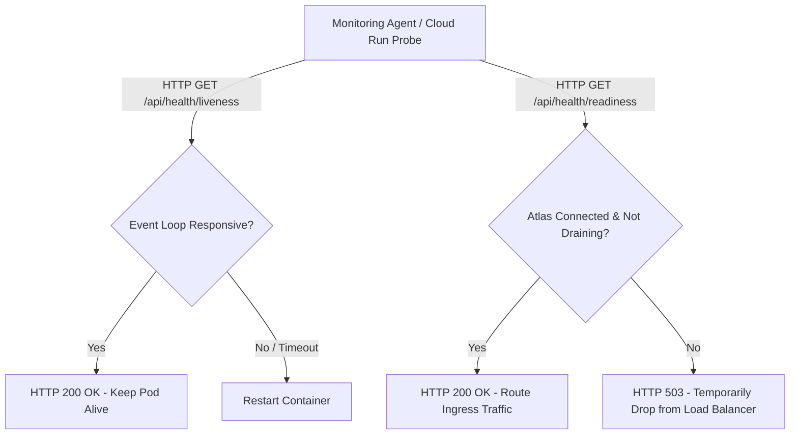

# 15 — Monitoring and Incident Management

- **Document Version**: 1.0.0
- **Status**: IMPLEMENTED AND VERIFIED (Probes & Logging) / PROPOSED (Alerting & PagerDuty)
- **Last Reviewed**: 2026-11-11
- **Target Audience**: SREs, DevOps Engineers, On-Call Engineers, System Administrators

---

## 1. Monitoring Capabilities Overview

CampusConnect incorporates internal health probes, structured logging, and database readiness inspection at the application runtime level:

| Subsystem | Implemented Component | Status | Operational Details |
|---|---|:---:|---|
| **Liveness Probe** | `/api/health/liveness` | **VERIFIED** | Validates Node.js event loop responsiveness; returns HTTP 200. |
| **Readiness Probe** | `/api/health/readiness` | **VERIFIED** | Inspects `mongoose.connection.readyState` (1 = connected). Returns 503 if disconnected in production. |
| **Structured Logging** | `src/server/logger.ts` | **VERIFIED** | JSON-formatted application logs with level flags (`INFO`, `WARN`, `ERROR`). |
| **Sensitive Redaction** | Application Filters | **VERIFIED** | Passwords, JWT secrets, and connection strings are masked from stdout. |
| **External Uptime Checks** | Google Cloud Monitoring | **PROPOSED** | Automated 60-second synthetic polling of `/api/health/liveness`. |
| **Centralized Error APM** | Sentry / Cloud Logging | **PROPOSED** | Real-time crash alerting and distributed stack-trace tracking. |

---

## 2. Health Probes & Diagnostic Metrics



### Health Probe Endpoints:
1. **Liveness**: `GET /api/health/liveness`
   - Emits process uptime, timestamp, and PID.
2. **Readiness**: `GET /api/health/readiness`
   - Returns `{ "status": "ready", "database": "connected", "mongoReadyState": 1 }`.
   - If Mongoose loses connection to Atlas in production, returns HTTP 503:
     `{ "status": "unavailable", "reason": "Database connection to MongoDB Atlas is recovering", "ready": false }`.

---

## 3. Incident Severity Classification Matrix

| Severity Level | Definition | Impact Examples | Response SLA | Target Resolution |
|:---:|---|---|:---:|:---:|
| **SEV-1 (Critical)** | Core system offline or catastrophic security compromise. | Database unreachable; authentication broken for all users; data leak. | **< 15 Minutes** | < 2 Hours |
| **SEV-2 (High)** | Major functional degradation affecting significant user cohorts. | Ticket submissions failing; OTP emails failing to dispatch; rate limiter stuck. | **< 30 Minutes** | < 4 Hours |
| **SEV-3 (Medium)** | Non-critical functionality degraded with available workaround. | Image uploads intermittently failing; announcement formatting defect. | **< 2 Hours** | < 24 Hours |
| **SEV-4 (Low)** | Minor cosmetic, non-blocking bug or documentation issue. | Visual misalignment in dark mode; typo in email notification template. | **< 8 Hours** | Next Sprint |

---

## 4. Standard Incident Response Runbooks

### Runbook 1: Total Application Downtime (SEV-1)
1. **Symptom**: Cloud Run returns HTTP 502/503 or health check fails continuously.
2. **Diagnosis**:
   - Check Cloud Run logs for startup errors (`[FATAL CONFIGURATION ERROR]`).
   - Confirm container did not fail `validateJwtConfiguration()` or `validateStorageConfiguration()`.
3. **Action**:
   - Check Cloud Run revision history.
   - If a recent revision is failing, execute immediate rollback:
     ```bash
     gcloud run services update-traffic campusconnect-prod --to-revisions PREVIOUS_HEALTHY=100
     ```

### Runbook 2: MongoDB Atlas Disconnection (SEV-1)
1. **Symptom**: Readiness probe returns HTTP 503 with `"isDatabaseUnavailable": true`.
2. **Diagnosis**:
   - Inspect Atlas cluster status at [MongoDB Cloud Status](https://status.mongodb.com).
   - Check if current Cloud Run egress IP is authorized under Atlas Network Access.
3. **Action**:
   - Confirm network access rules in MongoDB Atlas.
   - If connection pool exhausted, check for unindexed slow queries in Atlas Real-Time Performance Panel.

### Runbook 3: Authentication & Login Failure (SEV-1)
1. **Symptom**: All users receiving `401 Unauthorized` or `500 Internal Server Error` on login.
2. **Diagnosis**:
   - Inspect logs for `[FATAL] JWT_SECRET` mismatch or token decryption failure.
   - Verify that `JWT_SECRET` environment variable was not rotated unexpectedly without a grace transition.
3. **Action**:
   - Restore previous valid `JWT_SECRET` in Secret Manager.

### Runbook 4: Email / OTP Delivery Failure (SEV-2)
1. **Symptom**: Students reporting missing password reset codes.
2. **Diagnosis**:
   - Check server logs for `[EMAIL WARN] Resend API key missing` or `Resend API Error 401/403`.
   - Verify Resend quota limits and domain DNS verification status.
3. **Action**:
   - Verify `RESEND_API_KEY` validity in Secret Manager.
   - If Resend service has an outage, monitor [Resend Status](https://resend-status.com).

### Runbook 5: Security / Unauthorized Tampering Incident (SEV-1)
1. **Symptom**: Evidence of cross-tenant data access or attempted IDOR exploitation.
2. **Diagnosis**:
   - Query `auditlogs` collection for suspicious admin operations:
     ```bash
     GET /api/admin/audit-logs
     ```
   - Check logs for blocked cross-tenant attempts.
3. **Action**:
   - Immediately freeze compromised staff accounts via `/api/admin/staff/:id/toggle-disable`.
   - Rotate `JWT_SECRET` in Secret Manager to invalidate all active JWT sessions across the cluster.
