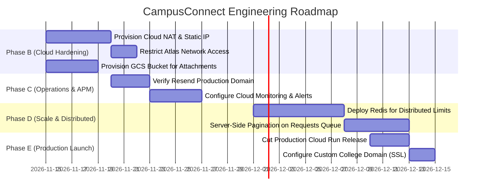

# 18 — Known Limitations and Future Roadmap

- **Document Version**: 1.0.0
- **Status**: IMPLEMENTED AND VERIFIED (Audit Findings)
- **Last Reviewed**: 2026-11-11
- **Target Audience**: Product Managers, Engineering Leads, System Architects, Evaluators

---

## 1. Technical Audit Overview

In strict adherence to Level 10 handover standards, this document honestly itemizes the technical boundaries, unverified modules, and infrastructure prerequisites currently present in the CampusConnect project.

---

## 2. Infrastructure & Cloud Operations Limitations

### 1. Persistent Cloud Storage for Attachments
- **Description**: Ticket attachments are currently written to local disk (`.data/uploads/` or `/uploads/`).
- **Current Status**: **PARTIALLY IMPLEMENTED / PLANNED**.
- **Impact**: Files written to local container disk will not persist across Cloud Run container redeployments or multi-instance scaling.
- **Priority**: **HIGH (P1)**.
- **Dependencies**: Google Cloud Storage bucket provisioning (`gs://campusconnect-prod-attachments`).
- **Recommended Next Step**: Provision bucket, configure Service Account with `Storage Object Admin`, and activate `GoogleCloudStorageProvider` in `src/server/storage.ts`.

---

### 2. Static Egress IP & Restricted MongoDB Atlas Access List
- **Description**: MongoDB Atlas currently allows network access from any IP (`0.0.0.0/0`) because Cloud Run egress IPs fluctuate dynamically.
- **Current Status**: **PLANNED (Gate 3 Architecture Prepared)**.
- **Impact**: Database port 27017 is exposed to the public internet (protected only by database user authentication and TLS encryption).
- **Priority**: **HIGH (P1)**.
- **Dependencies**: Serverless VPC Access Connector + Cloud NAT Gateway with a reserved Static External IP address.
- **Recommended Next Step**: Provision Cloud NAT, configure VPC Connector in Cloud Run, and restrict Atlas Network Access strictly to the reserved static IP.

---

### 3. Continuous Backups & Point-in-Time Recovery (PITR)
- **Description**: The active cluster runs on MongoDB Atlas M0 (Free Tier), which does not support continuous cloud snapshots or PITR.
- **Current Status**: **NOT AVAILABLE ON CURRENT CLUSTER TIER**.
- **Impact**: Recovery from catastrophic data corruption is limited to manual `mongodump` snapshots.
- **Priority**: **MEDIUM (P2)**.
- **Dependencies**: Upgrade to MongoDB Atlas M10+ dedicated cluster tier (~$57/month).
- **Recommended Next Step**: Upgrade cluster tier when funding is approved and activate 7-day automated PITR snapshots.

---

### 4. Separate Staging Database Namespace
- **Description**: Currently, both local development and testing target the single `campusconnect` cluster (with UAT guarded by `test/run-uat-guard.ts`).
- **Current Status**: **PLANNED (Gate 2)**.
- **Impact**: Staging verification cannot run against live cloud infrastructure without provisioning an isolated database namespace.
- **Priority**: **MEDIUM (P2)**.
- **Dependencies**: Creation of `campusconnect_staging` database in Atlas.
- **Recommended Next Step**: Provision staging database and configure `campusconnect-staging` Cloud Run revision.

---

## 3. Application Architecture & Reliability Limitations

### 5. Distributed Rate Limiting (In-Memory `express-rate-limit`)
- **Description**: Rate limit counters are tracked in the memory of the Node.js process using default memory stores.
- **Current Status**: **IMPLEMENTED (In-Memory)**.
- **Impact**: When Cloud Run scales to multiple container instances, rate limits are tracked per-instance rather than globally across the cluster.
- **Priority**: **MEDIUM (P2)**.
- **Dependencies**: Redis / Cloud Memorystore instance.
- **Recommended Next Step**: Implement `rate-limit-redis` adapter for distributed multi-instance counting.

---

### 6. In-Memory Idempotency Cache
- **Description**: Idempotency keys (`x-idempotency-key`) are cached in a process-local LRU map (`src/server/resilience.ts`).
- **Current Status**: **IMPLEMENTED (In-Memory)**.
- **Impact**: Duplicate write protection protects against single-process rapid retries, but is not shared across multi-instance container replicas.
- **Priority**: **LOW (P3)**.
- **Dependencies**: Redis / Cloud Memorystore cache.
- **Recommended Next Step**: Back the idempotency middleware with Redis storage.

---

### 7. Pagination Coverage Across All Endpoints
- **Description**: Server-side cursor/offset pagination (`page`, `limit`, standard headers) was implemented for `GET /api/admin/students` and `GET /api/admin/audit-logs`. Endpoints such as `GET /api/requests` and `GET /api/notifications` currently return full filtered arrays.
- **Current Status**: **PARTIALLY IMPLEMENTED**.
- **Impact**: Acceptable for current data volumes; will experience latency on accounts with thousands of tickets.
- **Priority**: **MEDIUM (P2)**.
- **Dependencies**: Frontend infinite-scroll or pagination controls.
- **Recommended Next Step**: Extend `limit` and `page` parameters to `GET /api/requests`.

---

## 4. Operational & External Service Limitations

### 8. Production Email Domain Verification (Resend)
- **Description**: Email dispatch code is functional in `src/server/email.ts`, but the sender address is currently configured for development fallbacks.
- **Current Status**: **PARTIALLY IMPLEMENTED**.
- **Impact**: In production, reset emails will fail or deliver to spam if the sending domain is not verified with DKIM/SPF in Resend.
- **Priority**: **HIGH (P1)**.
- **Dependencies**: Institutional DNS access to add Resend DKIM/SPF records.
- **Recommended Next Step**: Add college domain (e.g. `mail.yourcollege.edu`) to Resend dashboard and verify DNS records.

---

### 9. Headless Browser Automation (Playwright/Puppeteer)
- **Description**: The current development container lacks Chrome/Chromium binaries, precluding end-to-end visual rendering tests in CI.
- **Current Status**: **BLOCKED BY CONTAINER ENVIRONMENT BINARIES**.
- **Impact**: Visual layout and CSS rendering must be verified manually in the browser.
- **Priority**: **LOW (P3)**.
- **Dependencies**: Container Dockerfile update to include Chromium libraries.
- **Recommended Next Step**: Add Playwright base image to CI/CD pipeline for automated visual regression testing.

---

## 5. Strategic Roadmap Summary

